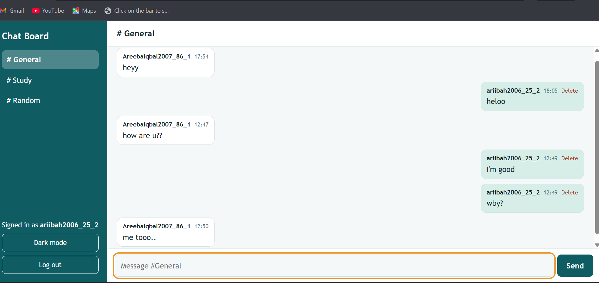
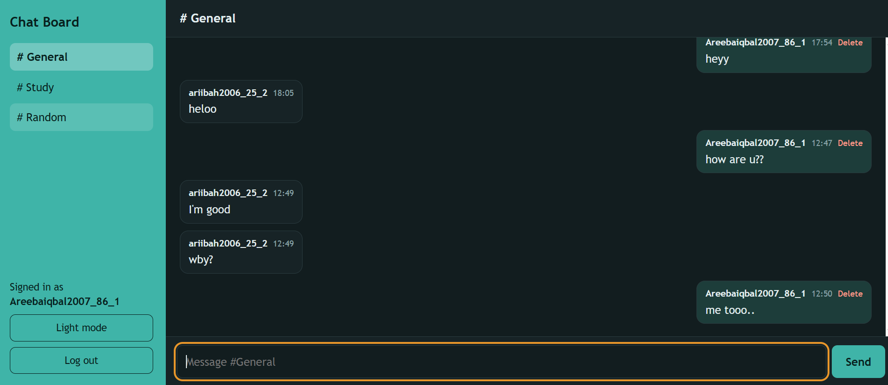

# Chat Board

A multi-room chat application built with plain PHP, MySQL, HTML, CSS and JavaScript (no frameworks).

**Live demo:** _add your link here_ · **Code:** this repository

| Dark mode | Mobile view |
|-----------|-------------|
|  |  |

## Features
- User registration and login (PHP sessions)
- Multiple chat rooms (General, Study, Random)
- Messages update automatically (JavaScript polling with `fetch`)
- Delete your own messages
- Dark mode (saved in the browser)
- Responsive layout for phones and desktops

## Tech stack
PHP 8, MySQL (PDO), HTML5, CSS3 (custom properties, grid, flexbox), vanilla JavaScript

## Security measures
- Passwords hashed with `password_hash()` / checked with `password_verify()`
- All SQL uses PDO prepared statements (prevents SQL injection)
- Output escaped with `htmlspecialchars()` in PHP and `textContent` in JavaScript (prevents XSS)
- CSRF token required on every state-changing request
- `session_regenerate_id()` on login (prevents session fixation)
- Users can only delete their own messages (checked in the SQL `WHERE` clause)
- Input validation on both username and message length

## Run locally
1. Install XAMPP and start **Apache** and **MySQL**.
2. Copy this folder to `htdocs/chat-board`.
3. Open phpMyAdmin, go to **Import**, and import `schema.sql`.
4. Copy `config.sample.php` to `config.php` and enter your database details (XAMPP defaults work as they are).
5. Visit `http://localhost/chat-board/register.php`.

## Deploy to shared hosting
1. Create a MySQL database in your hosting panel.
2. Import `schema-hosting.sql` (it has no `CREATE DATABASE` line, because hosting creates the database for you).
3. Upload the files and create `config.php` with the hosting database details.

## Project structure
| File | Purpose |
|------|---------|
| `config.sample.php` | Template for database settings, sessions, CSRF and helper functions |
| `register.php`, `login.php`, `logout.php` | Authentication |
| `index.php` | Chat page (rooms, layout) |
| `api.php` | JSON endpoint: list, send and delete messages |
| `chat.js` | Fetches and renders messages, sends and deletes |
| `theme.js` | Dark mode toggle |
| `style.css` | All styling |
| `schema.sql`, `schema-hosting.sql` | Database tables and starter rooms |

## What I learned
- Designing a small relational schema with foreign keys
- Building a JSON API in plain PHP and consuming it with `fetch`
- Protecting an app against SQL injection, XSS and CSRF

## Ideas for future work
- Real-time updates with WebSockets
- Rate limiting, message editing, private messages
- Admin and moderation tools
